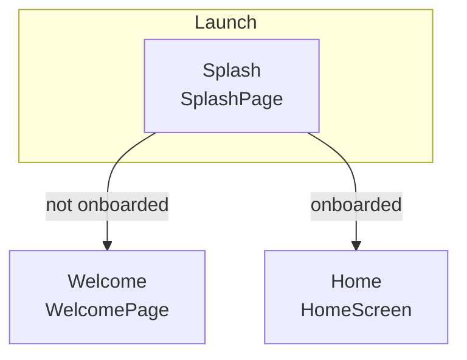
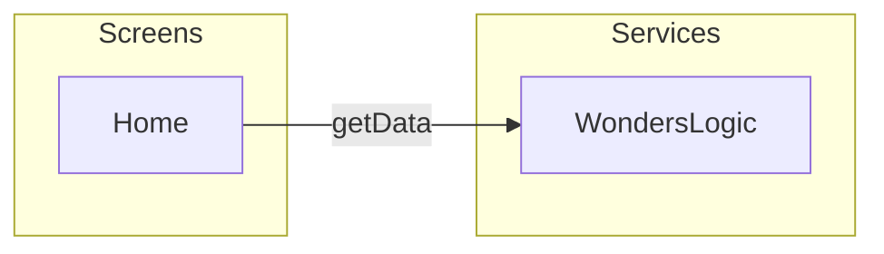

## Screens · how the user moves

One or two sentences: where the app opens and how the user gets around.

- `───▷` opens
- `▭` tap to open its module

## Services · what the screens talk through

One or two sentences: the services that own shared concerns.

- `───▷` calls, labelled with the method
- `▭` tap to open its module
