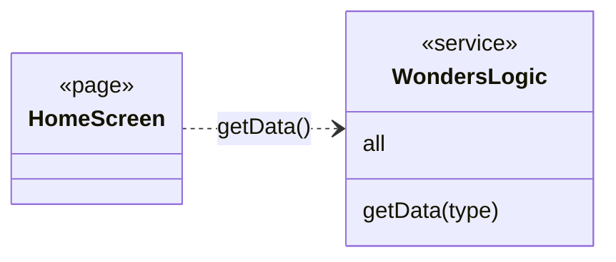
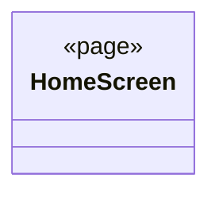
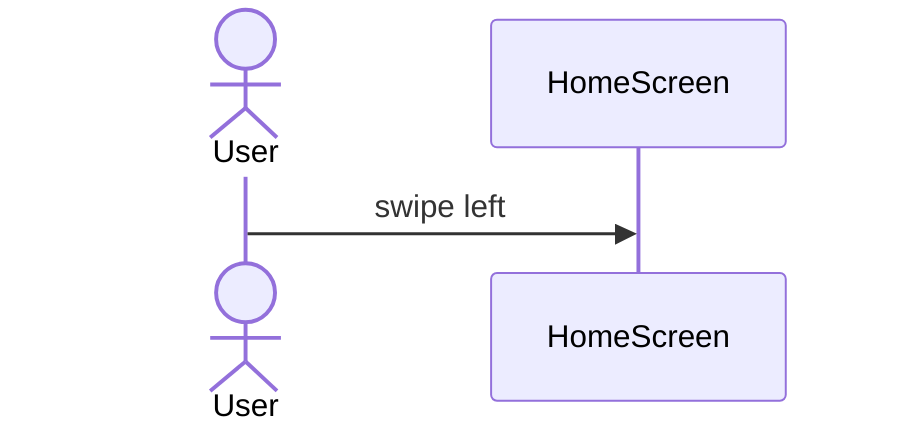

## What it does

3–6 plain sentences: what the user gets, the rules the code enforces (timings, limits, what is
saved) with the real numbers, and where the module hands off.

## Logic · class diagram {#classes}

One sentence naming the main idea, not listing boxes.

- `──▷` holds
- `◇──` list of
- `┄┄▷` uses
- `──▷|` extends

## Screen · widget composition {#widgets}

One sentence: how the screen is put together.

- `◆──` contains
- `──▷` reads model
- `┄┄▷` builds

## Swipe to the next wonder · sequence {#sequence}

One sentence on the rule the flow depends on.

## Key files {#files}

- `lib/ui/screens/home/wonders_home_screen.dart` · carousel and swipe handling
