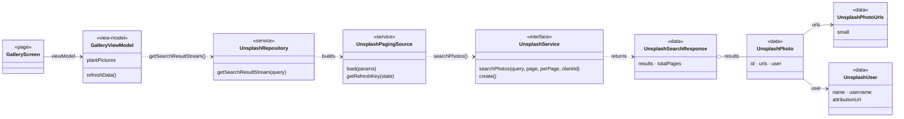
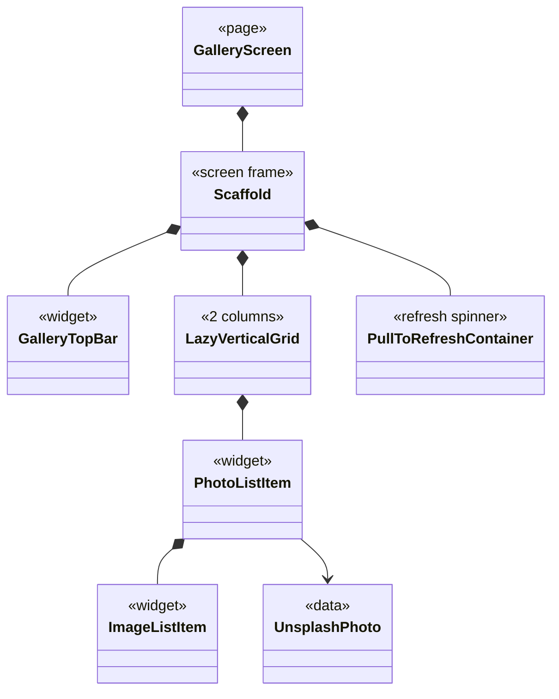
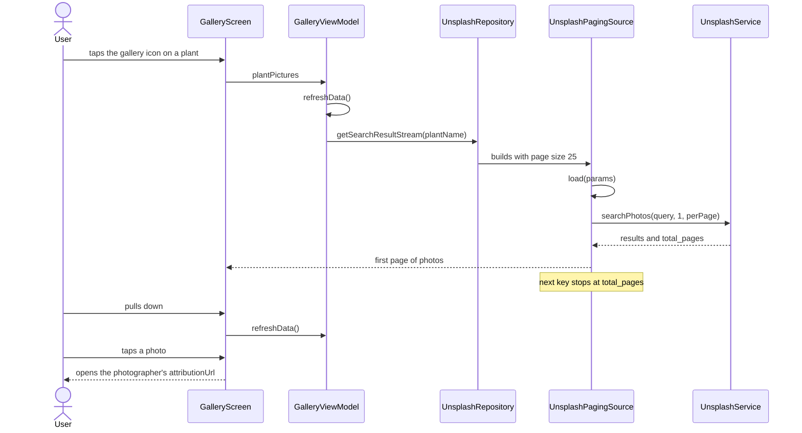

## What it does

Opened at `gallery/{plantName}` from a plant's detail page, only in builds with an Unsplash key. It searches Unsplash for the plant's name and shows the photos in a 2-column grid of cards labelled with the photographer's name, loading 25 per page starting at page 1 and stopping at the response's `total_pages`. Pulling down reloads the search; the spinner ends when the refresh finishes or fails. Tapping a photo opens the photographer's Unsplash profile in the browser with sunflower referral parameters; the back arrow returns to the plant.

## Logic · class diagram {#classes}

The view-model asks the repository for a paging stream; a paging source turns page keys into Unsplash search calls.

- `──▷` holds
- `◇──` list of
- `┄┄▷` uses

## Screen · widget composition {#widgets}

A `Scaffold` with a back bar and a pull-to-refresh grid of photo cards.

- `◆──` contains
- `──▷` reads model

## Browse a plant's photos · sequence {#sequence}

The view-model loads on creation, so the grid fills without any user action.

## Key files {#files}

- `app/src/main/java/com/google/samples/apps/sunflower/compose/gallery/` · gallery grid and top bar
- `app/src/main/java/com/google/samples/apps/sunflower/viewmodels/GalleryViewModel.kt` · photo stream and refresh
- `app/src/main/java/com/google/samples/apps/sunflower/data/UnsplashRepository.kt` · pager config
- `app/src/main/java/com/google/samples/apps/sunflower/data/UnsplashPagingSource.kt` · page keys and loads
- `app/src/main/java/com/google/samples/apps/sunflower/api/` · Retrofit Unsplash API
- `app/src/main/java/com/google/samples/apps/sunflower/data/` · Unsplash response models (`Unsplash*.kt`)
