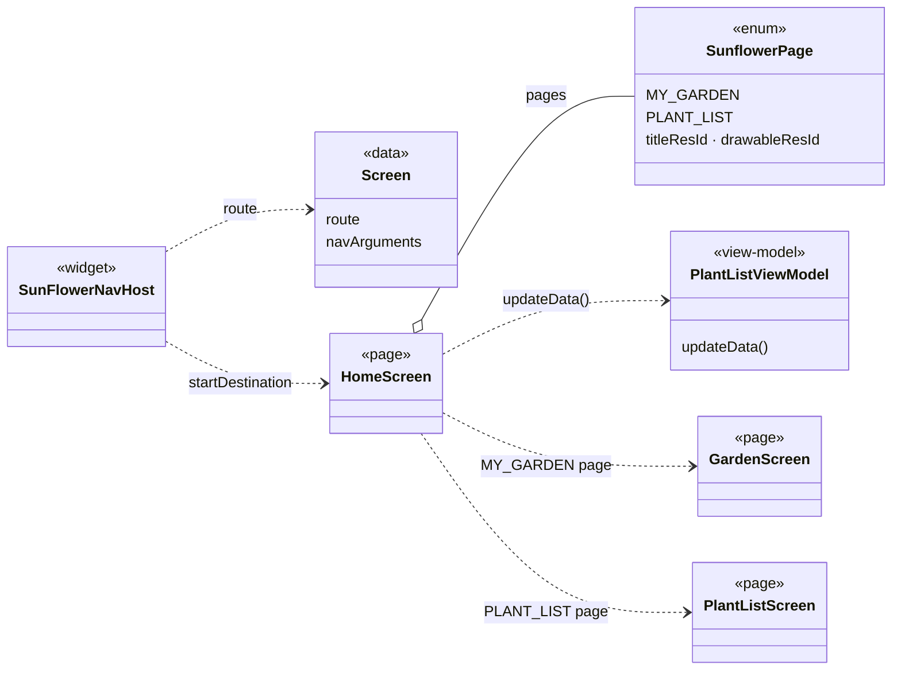
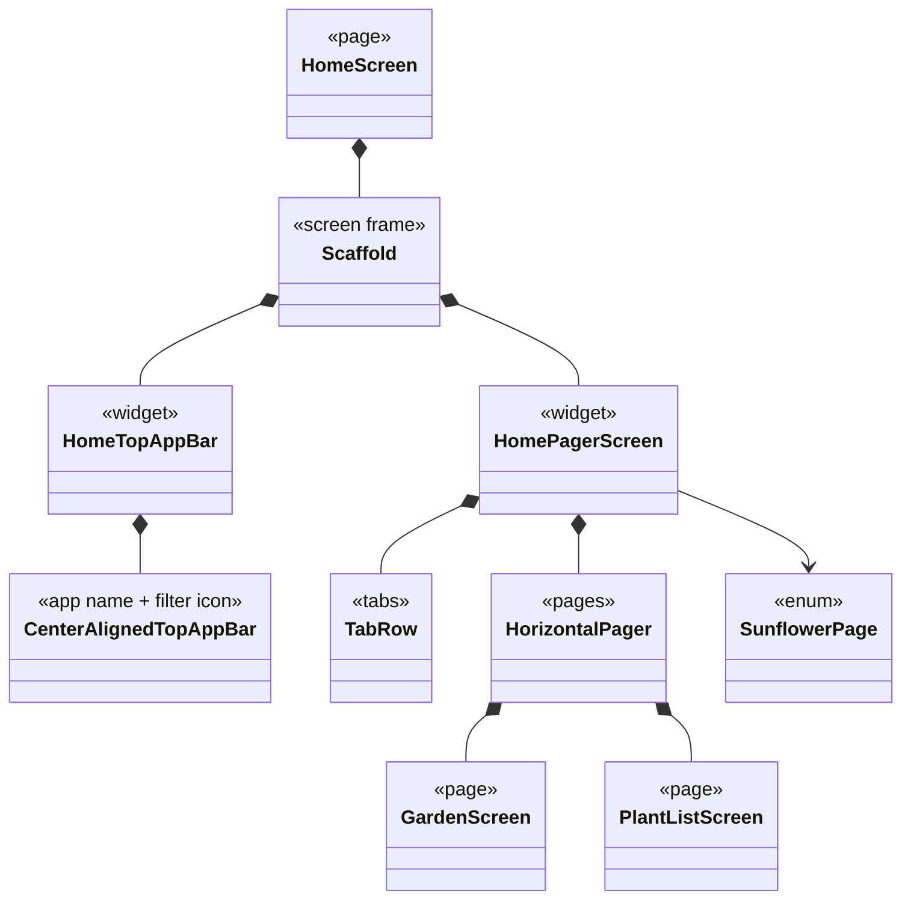
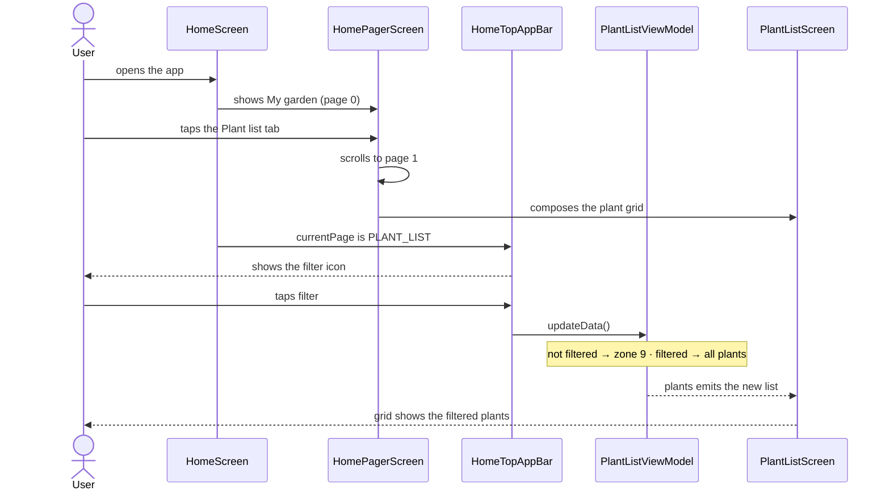

## What it does

Home is the start route (`home`). A centred app bar shows the app name and collapses as the content scrolls (`enterAlwaysScrollBehavior`). Below it a `TabRow` and a `HorizontalPager` hold the two pages of `SunflowerPage`: **My garden** and **Plant list**; tapping a tab animates the pager to it. The filter icon appears only while the Plant list page is showing; it calls `PlantListViewModel.updateData()`, which toggles between all plants and grow zone 9. Tapping a plant on either page navigates to `plantDetail/{plantId}`.

## Logic · class diagram {#classes}

Home owns the pager and the filter button; each tab page brings its own view-model.

- `◇──` list of
- `┄┄▷` uses · opens

## Screen · widget composition {#widgets}

A `Scaffold` with the collapsing app bar on top and the tab row plus pager below.

- `◆──` contains
- `──▷` reads model

## Switch tab and filter the plant list · sequence {#sequence}

The filter icon only exists while the pager's current page is Plant list.

## Key files {#files}

- `app/src/main/java/com/google/samples/apps/sunflower/compose/home/` · home screen, pager, app bar, tabs enum
- `app/src/main/java/com/google/samples/apps/sunflower/compose/SunflowerApp.kt` · navigation between screens
