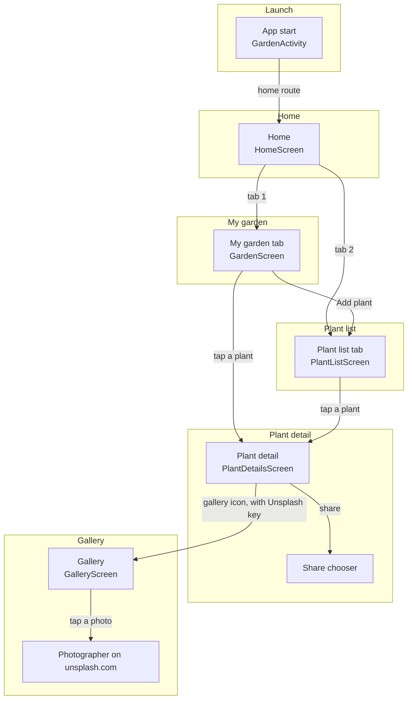
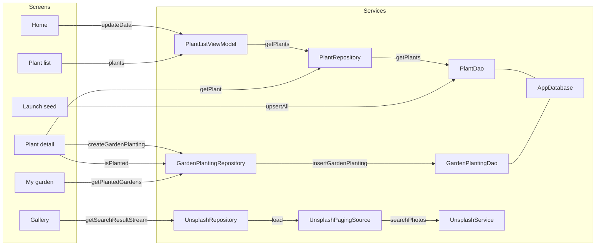

## Screens · how the user moves

The single activity opens Home on the My garden tab; plants open their detail page from either tab, and the detail page leads to the gallery.

- `───▷` opens
- `▭` tap to open its module

## Services · what the screens talk through {#services}

Two Room repositories are shared by the garden, the plant list and the detail page; the gallery alone talks to Unsplash.

- `───▷` calls, labelled with the method
- `───` belongs to
- `▭` tap to open its module
