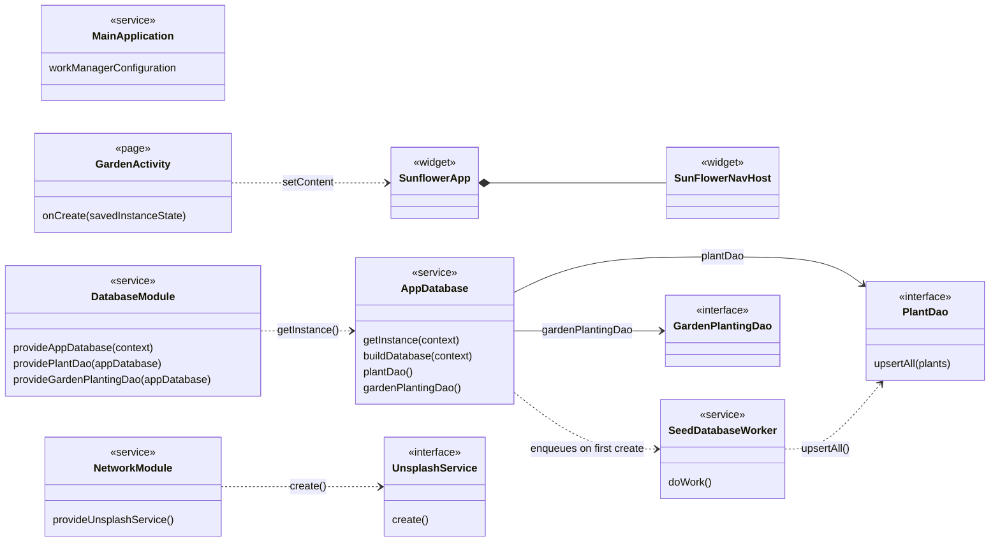
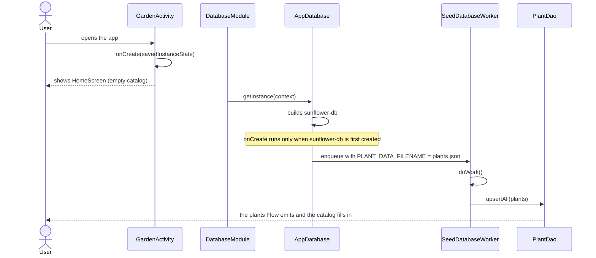

## What it does

`MainApplication` starts Hilt and gives WorkManager its configuration (DEBUG logging in debug builds, ERROR otherwise). `GardenActivity` draws edge-to-edge and hosts the whole Compose UI inside `SunflowerTheme`; `SunFlowerNavHost` opens on the `home` route. The Room database `sunflower-db` holds two tables, `plants` and `garden_plantings`. The first time it is created, a one-time `SeedDatabaseWorker` reads `plants.json` from the app's assets and upserts every plant, so the catalog appears shortly after the first launch. Hilt's `DatabaseModule` and `NetworkModule` provide the database, its two DAOs and the Unsplash service as singletons the other modules share.

## Logic · class diagram {#classes}

The activity only hosts Compose; the data layer is built once by Hilt and seeded by a background worker.

- `──▷` holds
- `┄┄▷` uses
- `◆──` contains

## Seed the plant catalog on first launch · sequence {#sequence}

Seeding runs only from Room's `onCreate` callback, so it happens once per install.

## Key files {#files}

- `app/src/main/java/com/google/samples/apps/sunflower/MainApplication.kt` · Hilt app, WorkManager config
- `app/src/main/java/com/google/samples/apps/sunflower/GardenActivity.kt` · the single activity
- `app/src/main/java/com/google/samples/apps/sunflower/compose/SunflowerApp.kt` · nav host and share intent
- `app/src/main/java/com/google/samples/apps/sunflower/compose/Screen.kt` · route definitions
- `app/src/main/java/com/google/samples/apps/sunflower/di/` · Hilt database and network modules
- `app/src/main/java/com/google/samples/apps/sunflower/data/AppDatabase.kt` · Room database and seed callback
- `app/src/main/java/com/google/samples/apps/sunflower/workers/` · catalog seed worker
- `app/src/main/java/com/google/samples/apps/sunflower/utilities/Constants.kt` · database and asset names
- `app/src/main/java/com/google/samples/apps/sunflower/ui/` · theme, colors, type, shapes
- `app/src/main/assets/plants.json` · the seeded plant catalog
