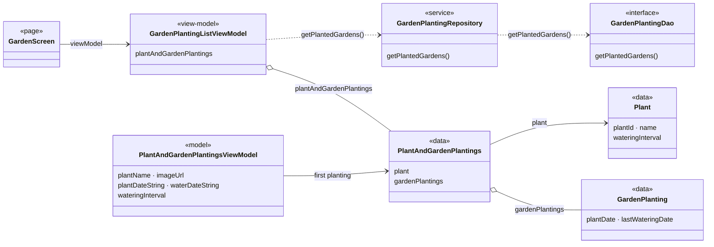
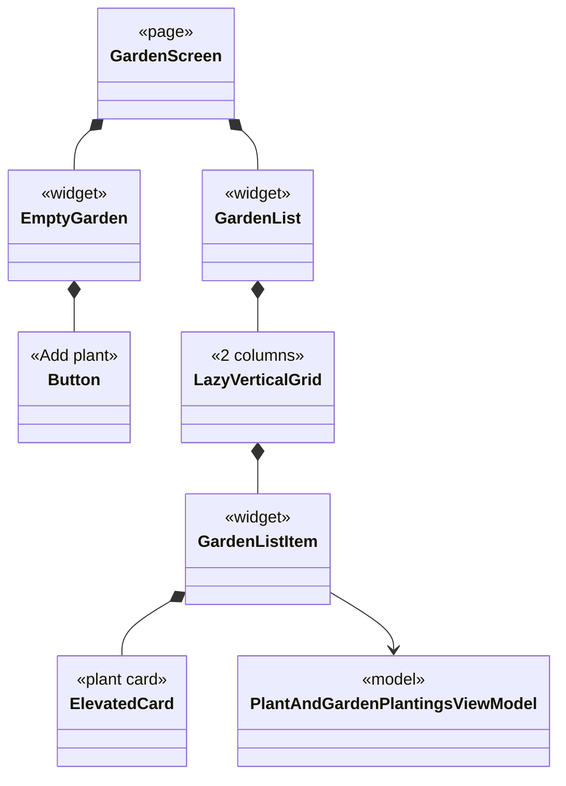
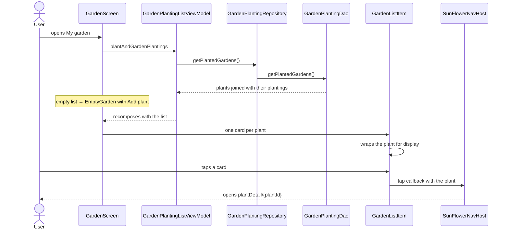

## What it does

My garden is the first tab of Home. It lists every plant that has at least one row in `garden_plantings`, in a 2-column grid. Each card shows the plant's image, name, the date it was planted and the date it was last watered (formatted `MMM d, yyyy`), and "water in N days" from the plant's watering interval (7 days unless the catalog says otherwise). With no plantings, it shows an empty message and an **Add plant** button that scrolls the pager to the Plant list tab. Tapping a card opens that plant's details. The list stays subscribed for 5 s after the screen stops collecting (`WhileSubscribed(5000)`).

## Logic · class diagram {#classes}

The view-model exposes one Room query that joins each plant with its plantings; each card wraps one result in a small display model.

- `──▷` holds
- `◇──` list of
- `┄┄▷` uses

## Screen · widget composition {#widgets}

The screen picks between the empty state and the grid of cards.

- `◆──` contains
- `──▷` reads model

## Open a planted plant · sequence {#sequence}

The grid only appears once the join query returns at least one plant.

## Key files {#files}

- `app/src/main/java/com/google/samples/apps/sunflower/compose/garden/` · garden grid, card, empty state
- `app/src/main/java/com/google/samples/apps/sunflower/viewmodels/GardenPlantingListViewModel.kt` · planted plants
- `app/src/main/java/com/google/samples/apps/sunflower/viewmodels/PlantAndGardenPlantingsViewModel.kt` · card text and dates
- `app/src/main/java/com/google/samples/apps/sunflower/data/GardenPlantingRepository.kt` · planting operations
- `app/src/main/java/com/google/samples/apps/sunflower/data/GardenPlantingDao.kt` · planting queries
- `app/src/main/java/com/google/samples/apps/sunflower/data/GardenPlanting.kt` · planting entity
- `app/src/main/java/com/google/samples/apps/sunflower/data/PlantAndGardenPlantings.kt` · plant + plantings relation
