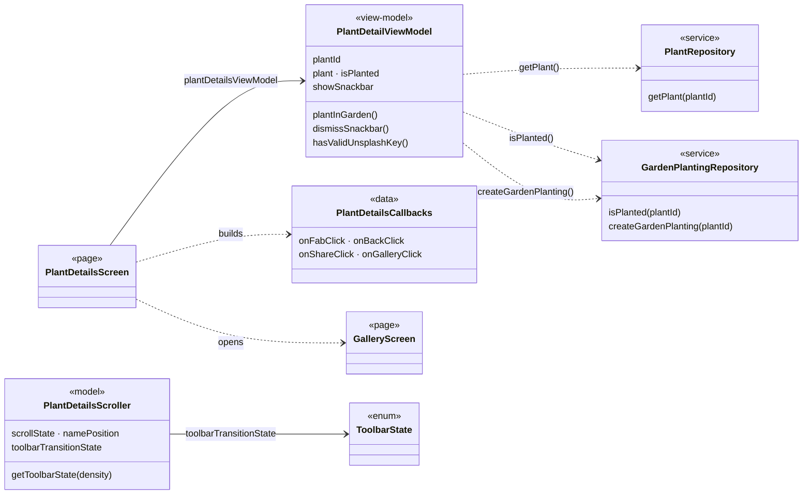
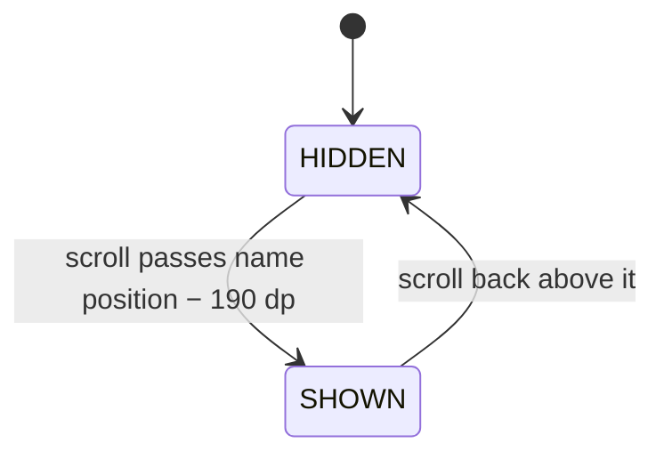
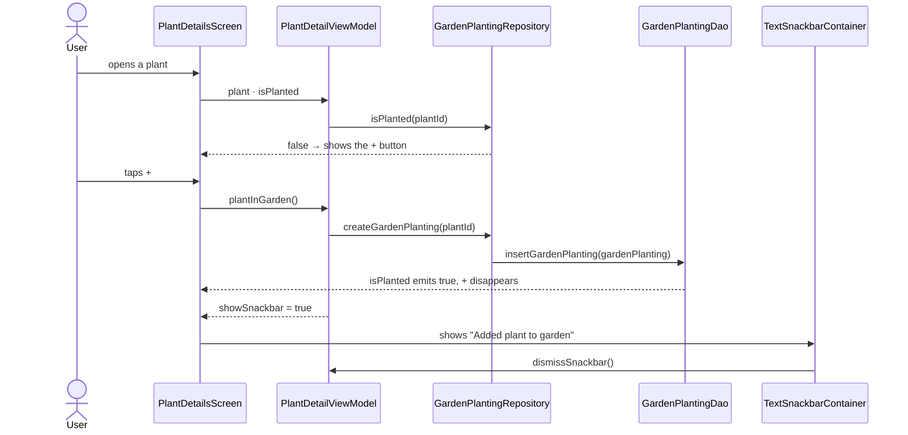

## What it does

Opened at `plantDetail/{plantId}` from either Home tab. A full-width header image sits above the plant's name, its watering needs ("every N days") and an HTML description with clickable links. While the plant is not in the garden a **+** button sits on the image's bottom edge; tapping it inserts a `GardenPlanting` dated today and shows a short "Added plant to garden" snackbar, after which the button disappears because `isPlanted` turns true. The gallery icon appears only when the build has an Unsplash key (`UNSPLASH_ACCESS_KEY` is not `"null"`) and opens `gallery/{plantName}`. Scrolling the name to within 190 dp of the top fades the header out and a top app bar with the plant's name in; back and share stay available in both states, and share opens the system chooser with a text about the plant.

## Logic · class diagram {#classes}

The view-model follows the plant and whether it is planted; a small scroller object decides when the toolbar shows.

- `──▷` holds
- `┄┄▷` uses · opens

## Screen · widget composition {#widgets}

A scrolling column with the header image, the add button and the plant's information, with a toolbar layered on top.

```mermaid
classDiagram
  direction TB
  class PlantDetailsScreen { <<page>> }
  class TextSnackbarContainer { <<widget>> }
  class PlantDetails { <<widget>> }
  class PlantDetailsContent { <<widget>> }
  class PlantImage { <<widget>> }
  class PlantFab { <<widget>> }
  class PlantInformation { <<widget>> }
  class PlantDescription { <<widget>> }
  class PlantToolbar { <<widget>> }
  class PlantDetailsToolbar { <<widget>> }
  class PlantHeaderActions { <<widget>> }
  class PlantDetailsScroller { <<model>> }
  class PlantDetailsCallbacks { <<data>> }
  PlantDetailsScreen *-- TextSnackbarContainer
  TextSnackbarContainer *-- PlantDetails
  PlantDetails *-- PlantDetailsContent
  PlantDetails *-- PlantToolbar
  PlantDetails --> PlantDetailsScroller
  PlantDetails --> PlantDetailsCallbacks
  PlantDetailsContent *-- PlantImage
  PlantDetailsContent *-- PlantFab
  PlantDetailsContent *-- PlantInformation
  PlantInformation *-- PlantDescription
  PlantToolbar *-- PlantDetailsToolbar
  PlantToolbar *-- PlantHeaderActions
```

- `◆──` contains
- `──▷` reads model

## Header and toolbar · state machine {#states}

`PlantToolbar` shows the header buttons while `HIDDEN` and the full app bar while `SHOWN`; both fade with a low-stiffness spring.

## Add a plant to My garden · sequence {#sequence}

The + button hides itself because `isPlanted` is a live Room query, not because the tap hides it.

## Key files {#files}

- `app/src/main/java/com/google/samples/apps/sunflower/compose/plantdetail/` · detail screen, toolbar, scroller
- `app/src/main/java/com/google/samples/apps/sunflower/viewmodels/PlantDetailViewModel.kt` · plant, planted state, add
- `app/src/main/java/com/google/samples/apps/sunflower/compose/utils/TextSnackbarContainer.kt` · snackbar wrapper
- `app/src/main/java/com/google/samples/apps/sunflower/compose/Modifiers.kt` · visible() modifier
- `app/src/main/java/com/google/samples/apps/sunflower/compose/Dimens.kt` · paddings and header height
