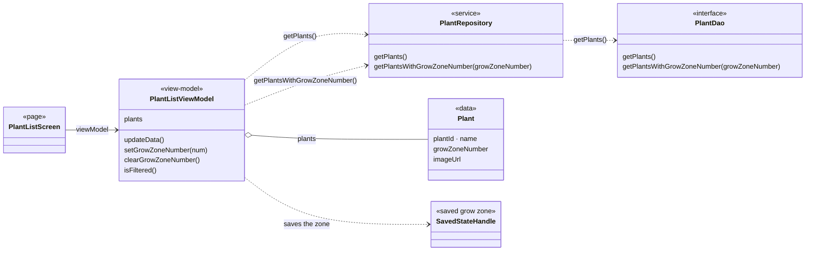
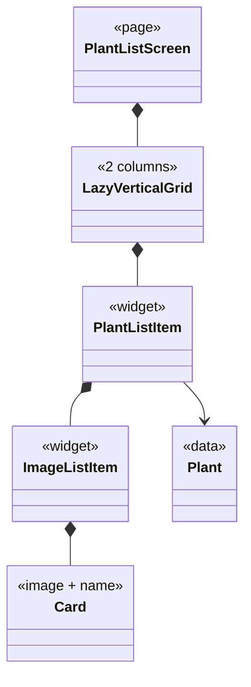
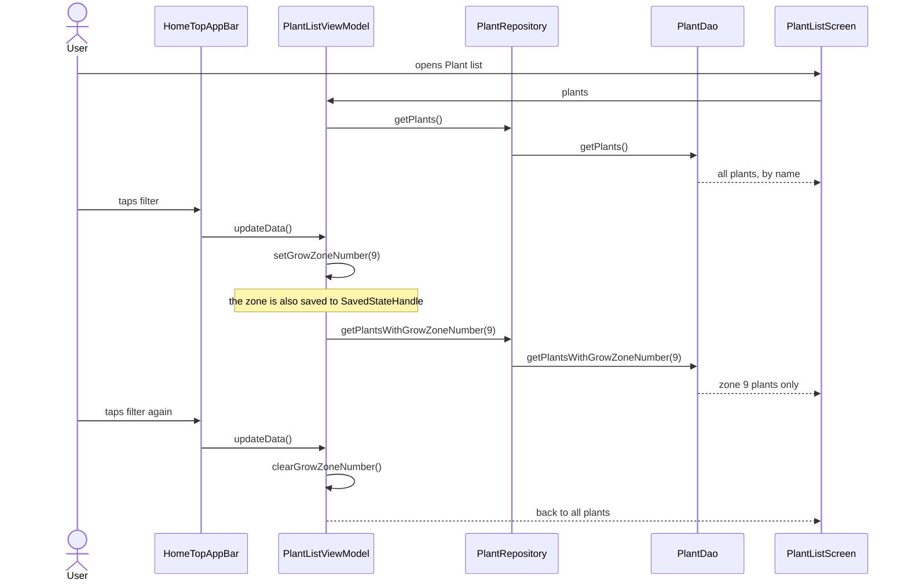

## What it does

Plant list is the second tab of Home. It shows every plant in the catalog, sorted by name, as a 2-column grid of image cards. The filter icon in the Home app bar toggles a grow-zone filter: off shows all plants, on shows only grow zone 9 (the zone is fixed in `updateData()`). The chosen zone is written to `SavedStateHandle`, so it survives process death; "no filter" is stored as -1. Tapping a card opens the plant's details.

## Logic · class diagram {#classes}

The current grow zone is a flow; switching it switches which Room query the list follows.

- `──▷` holds
- `◇──` list of
- `┄┄▷` uses

## Screen · widget composition {#widgets}

A grid of shared image cards; the same card is reused by the Gallery.

- `◆──` contains
- `──▷` reads model

## Filter to grow zone 9 · sequence {#sequence}

`flatMapLatest` drops the old query as soon as the zone changes.

## Key files {#files}

- `app/src/main/java/com/google/samples/apps/sunflower/compose/plantlist/` · plant grid and shared image card
- `app/src/main/java/com/google/samples/apps/sunflower/viewmodels/PlantListViewModel.kt` · plants and grow-zone filter
- `app/src/main/java/com/google/samples/apps/sunflower/data/PlantRepository.kt` · plant queries
- `app/src/main/java/com/google/samples/apps/sunflower/data/PlantDao.kt` · Room plant queries
- `app/src/main/java/com/google/samples/apps/sunflower/data/Plant.kt` · plant entity
- `app/src/main/java/com/google/samples/apps/sunflower/utilities/GrowZoneUtil.kt` · latitude → zone (only used by tests)
